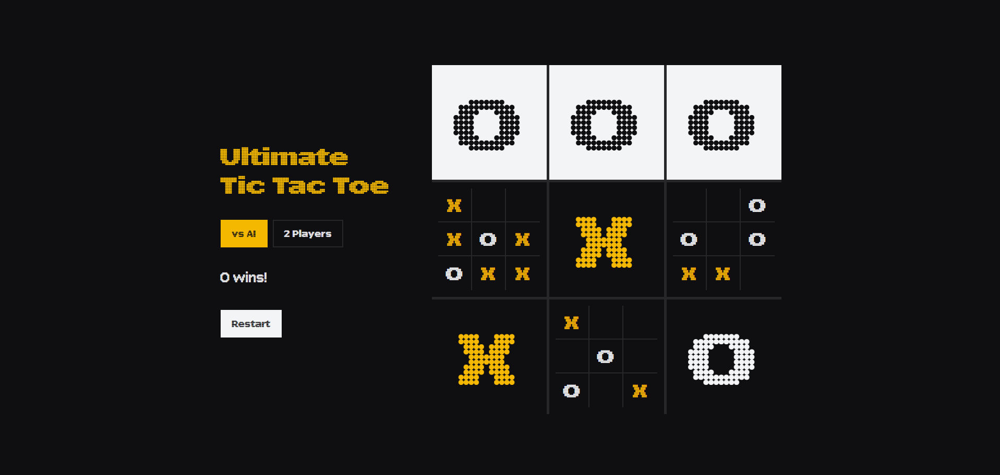

# Ultimate Tic Tac Toe

A 9x9 Ultimate Tic Tac Toe game built with vanilla HTML, CSS, and JavaScript. Each move you make sends your opponent to the corresponding mini-board. Win three mini-boards in a row to win the game.

### Features

- Play vs AI or with 2 players locally
- Active board highlighting to show valid moves
- Free-choice turn when sent to a finished board
- Responsive layout for desktop and mobile
- Restart button to quickly reset the game
